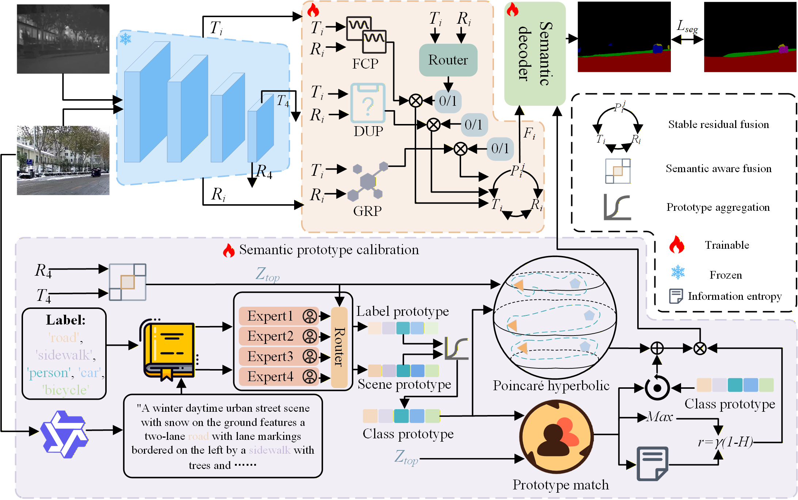

<div align="center">

# Semantics-to-Structure: Dual-Text Semantic Prototype Calibration and Hybrid Cross-Modal Prompting for RGB-T Snowy Urban Semantic Segmentation


</div>

## Architecture
<div align="center">
  
</div>

## Environment Setup

### 1. Create the environment

Python 3.9 is recommended. Install the PyTorch build that matches the local CUDA version before installing the remaining dependencies.

```bash
conda create -n S2S python=3.9 -y
conda activate S2S

pip install torch torchvision --index-url https://download.pytorch.org/whl/cu121
pip install -r requirements.txt
```

The PyTorch installation command above is only an example. Replace `cu121` with the CUDA version used by the local system.

Install the optional OpenAI CLIP dependencies only when required:

```bash
pip install -r requirements-clip.txt
```

### 2. Prepare pretrained models

Download the required DINOv3 and LongCLIP checkpoints and set their local paths in `configs/s2s_sus.json`:

```json
{
  "dinov3_local_path": "dinov3-main",
  "dinov3_weight_path": "/path/to/dinov3_checkpoint.pth",
  "longclip_repo": "LongCLIP",
  "longclip_checkpoint": "/path/to/longclip-B.pt"
}
```


## Training

Start single-GPU training:

```bash
python train.py \
  --config configs/s2s_sus.json \
  --gpu_ids 0 \
  --eval_split test \
  --log_root run
```

Start multi-GPU training with `DataParallel`:

```bash
python train.py \
  --config configs/s2s_sus.json \
  --gpu_ids 0,1 \
  --eval_split test
```
## Evaluation

Evaluate a checkpoint on the test split:

```bash
python evaluate.py \
  --config configs/s2s_sus.json \
  --checkpoint /path/to/model.pth \
  --splits test
```
